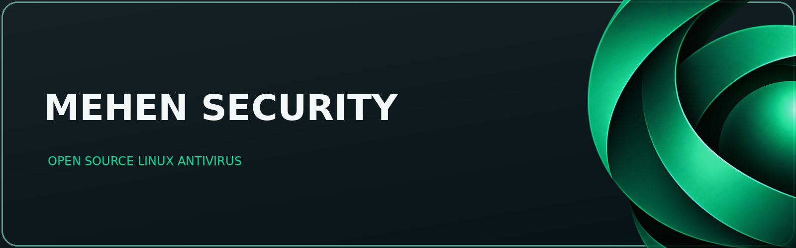

  

<h2 align="center">Protection that coils around your system.</h2>

 <b>Free, open-source antivirus for Linux Mint & Ubuntu,
made for people switching from Windows to Linux.</b> 

      

 <a href="https://YOUR-GITHUB-USERNAME.github.io/mehen-security/"><b>🌐 Website</b></a>  ·  <a href="../../releases"><b>⬇️ Download</b></a>  ·  <a href="#-install"><b>📦 Install</b></a>  ·  <a href="#-questions"><b>❓ FAQ</b></a>  ·  <a href="../../issues"><b>🐞 Report a bug</b></a> 

Mehen Security is a free, open-source antivirus for Linux Mint and Ubuntu that looks and works like the Windows antivirus you're used to. Install it with a double-click, never touch the terminal, and let it look after your laptop in the background while you settle into Linux.
[!NOTE] A new project, growing fast. Mehen Security is newly developed and in active, ongoing development. New features, improvements and fixes arrive regularly, and they reach you automatically through updates. Found a bug or have an idea? Let us know. Early feedback shapes what Mehen becomes.
🪟 Switching from Windows? Start here.
Moving to Linux is a great step for your privacy and freedom, but it can feel unfamiliar. Mehen keeps one thing feeling just like home: your antivirus.
	
🖥️ Familiar by design	A dashboard, Quick and Full scans, quarantine and a tray icon. If you've used antivirus on Windows, you already know how to use Mehen.
⌨️ No terminal required	Install with a double-click and control everything from buttons and menus. You'll never need to type a command.
🛡️ Looks after itself	Set it up once and Mehen works quietly in the background. It keeps its virus definitions up to date, runs scheduled scans and only speaks up when something needs your attention.
🔒 Shares Linux's values	Like Linux itself, Mehen is private, secure and open source. No accounts, no ads and no data leaving your computer.
🐍 Why Mehen?
Named after the coiled serpent of Egyptian myth who guarded the sun god on his journey through the night, Mehen is built to quietly guard your Linux desktop.
	
✨ ClamAV, made beautiful	ClamAV is a trusted, widely used open-source antivirus engine, but on its own it's a command-line tool built for experts. Mehen wraps it in a clean, easy-on-the-eye interface, so anyone can scan, review threats and stay up to date with a few clicks.
🐧 Made for Mint & Ubuntu	Designed and tested on Linux Mint and Ubuntu, so it installs cleanly and feels at home on your desktop.
📖 Fully open source	Every line of code is public. Read it, audit it, improve it. Nothing is hidden.
💚 Free, forever	No trials, no upsells, no subscriptions and no data collection. Just protection.
🔄 Stays up to date, on its own
You won't have to remember to update Mehen. It keeps itself current automatically.
	
🗄️ Virus definitions, every day	Mehen regularly downloads the latest virus signatures from ClamAV's official, verified update service in the background. The dashboard always shows when it last updated.
🔁 App updates in your Update Manager	New versions of Mehen appear in Linux Mint's Update Manager and Ubuntu's Software Updater, right alongside your other system updates. Click Install Updates as usual, just like Windows Update.
✅ Signed and verified	Updates are cryptographically signed and checked before they're installed, so you only ever receive genuine Mehen releases.
📦 Install
Three steps, no terminal needed. It works just like installing a program on Windows.
Download the installer. Grab the latest .deb file from the Releases page.
Double-click to install. Open your Downloads folder and double-click the file. Your system's installer opens. Click Install and enter your password when asked.
Open Mehen and you're set. Find Mehen Security in your applications menu (where Windows has the Start menu). A short setup guides you through your protection choices, then Mehen takes care of the rest.

 
<b>Prefer the terminal?</b> (optional, for experienced users)

From your Downloads folder:
sudo apt install ./mehen-security_*.deb

❓ Questions

 
<b>I've just switched from Windows. Is Mehen right for me?</b>

Yes. That's exactly who Mehen is designed for. It's built to feel like the Windows antivirus you know, needs no technical knowledge, and protects your computer automatically so you can focus on getting comfortable with Linux. 

 
<b>How is Mehen different from just using ClamAV?</b>

ClamAV provides the detection engine, a proven and trusted layer used around the world. On its own, though, it's operated by typing commands in a terminal. Mehen adds a friendly graphical app on top of it: clear buttons, a simple dashboard and plain-English results, so everyday computer users get ClamAV's protection without any technical know-how. 

 
<b>Who's behind Mehen?</b>

Mehen is a hobby project, not a company. It started as a side project by Panoptic7, someone with a long-standing interest in network and cyber security, and grew into a real program they felt was good enough to share with the world. It isn't a commercial product and never will be. There's nothing to buy, no business model and no profit motive, just a tool built out of curiosity and given away freely in the hope it helps people feel safer on Linux. 

 
<b>Was AI used to build Mehen?</b>

Yes, and we think you should know. With limited spare time and a goal of making Mehen as solid as possible, Panoptic7 uses Claude, an AI assistant made by Anthropic, to help write, check and test the code. Panoptic7 designs and directs the project and decides what goes into it. Every change is tested and published in the open. Before any stable release, Mehen's security-critical parts are planned for independent human review. If you spot something that doesn't look right, please open an issue. Scrutiny makes open source better. 

 
<b>Is it really free?</b>

Yes. Mehen Security is free and open source. There is no paid version. 

 
<b>Which systems does it support?</b>

Linux Mint and Ubuntu. Other Debian-based distributions may work but aren't officially tested yet. 

 
<b>Does Linux even need antivirus?</b>

Linux is less targeted than other systems, but it isn't immune, and scanning helps catch malicious files before you pass them on to Windows or Mac users. 

 
<b>How can I report a bug or help out?</b>

Open an issue on the GitHub issues page. Contributions are welcome. 

📜 License
Released under the GNU General Public License v3.0. Detection powered by ClamAV.

👁️ crafted by <b>PANOPTIC7</b> + claude

